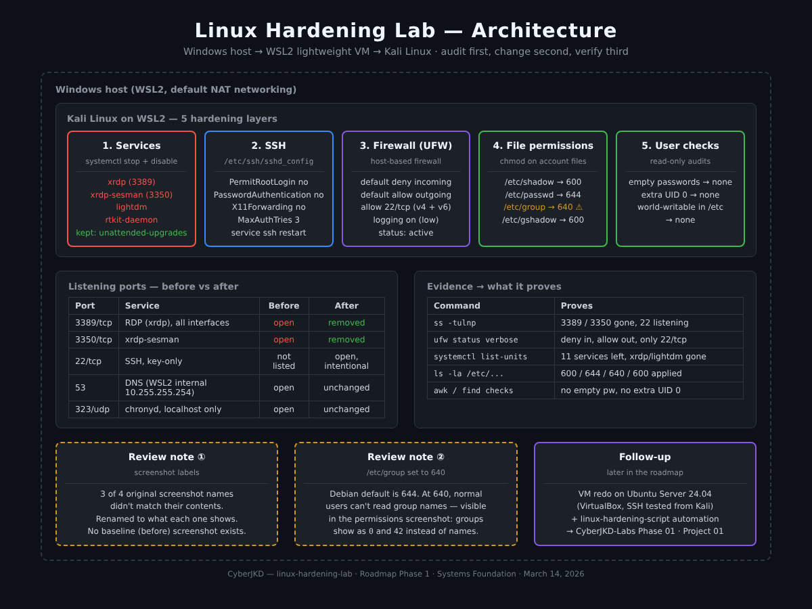
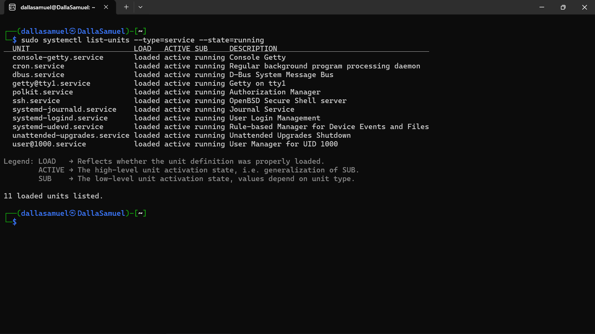
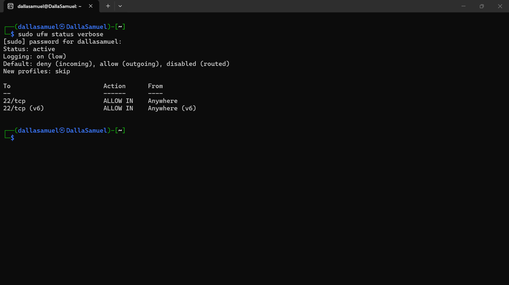
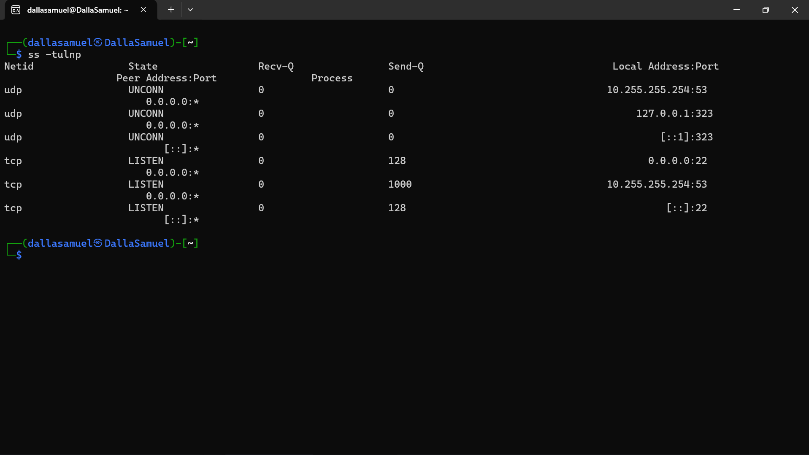
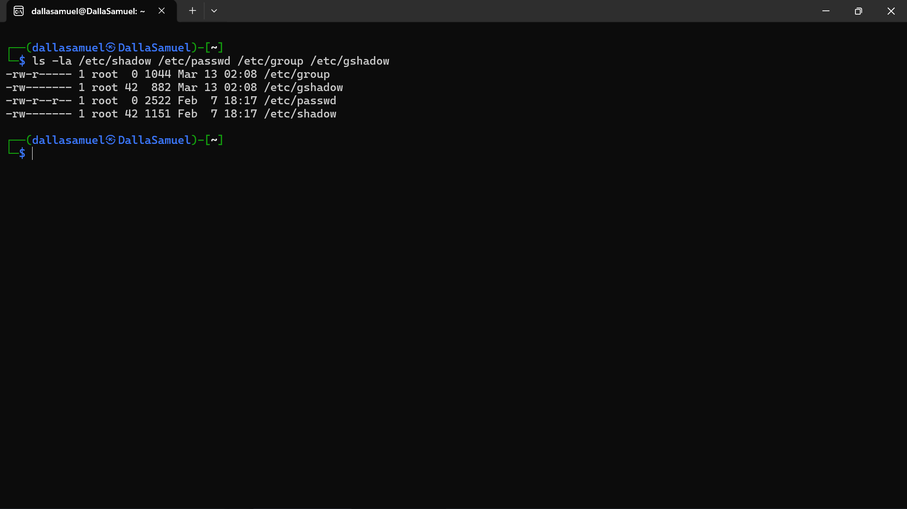

# Linux Hardening Lab - Kali Linux on WSL2


| | |
|---|---|
| **Author** | Dalla Samuel (CyberJKD) |
| **Date** | March 14, 2026 |
| **Target System** | Kali Linux on WSL2 (Windows host) |
| **Roadmap** | Phase 1 · Systems Foundation · first hardening lab |
| **Follow-up** | [VM redo on Ubuntu Server 24.04](https://github.com/DallaSamuel/CyberJKD-Labs/tree/main/phase-01/project-01-linux-hardening) · [linux-hardening-script](https://github.com/DallaSamuel/linux-hardening-script) |

---

## Objective

Harden a Kali Linux installation running on WSL2: reduce the attack surface, disable unnecessary services, configure firewall rules, lock down SSH and secure sensitive file permissions. Every change is documented as a reproducible checklist that can be applied to any Debian-based Linux system.

The approach follows one simple principle: **audit first, change second, verify third.** No change was made without understanding why it matters.

## Business Problem

A default Linux install is built to work out of the box, not to be secure. Services nobody uses stay running, remote-access ports listen on every interface, SSH allows password guessing, and there is no firewall. Each of those is an entry point. Every organization running Linux servers needs a repeatable way to find that exposure, close it, and prove it was closed. This lab is that process on a small scale.

## Environment

| Component | Value |
|---|---|
| Host | Windows, WSL2 (default NAT networking) |
| Distribution | Kali Linux (Debian-based) |
| Firewall | UFW (Uncomplicated Firewall) |
| Remote access | OpenSSH server (`ssh.service`) |
| Audit tools | `ss`, `systemctl`, `ufw`, `ls`, `awk`, `find` |
| WSL2 internal DNS | `10.255.255.254:53` |

## Key Concepts

- **Attack surface**: every listening port and running service is something an attacker can try to reach. Fewer services means fewer ways in.
- **Least privilege**: users, services and files get only the access they need to do their job.
- **Default-deny firewall**: block all inbound traffic, then allow only what is needed (here, SSH on 22/tcp).
- **SSH hardening**: no direct root login, key-only authentication, a limit on login attempts, and no GUI forwarding.
- **Account file permissions**: `/etc/shadow` and `/etc/gshadow` hold password hashes and must be root-only. `/etc/passwd` and `/etc/group` hold names and IDs that the system needs to read.
- **Audit, change, verify**: capture the starting state, make one change at a time, and prove each one worked.

## Architecture



```
Windows host
   │
   ▼
WSL2 lightweight VM (default NAT networking, internal DNS 10.255.255.254)
   └── Kali Linux
        ├── 1. Services     → stop + disable xrdp, xrdp-sesman, lightdm, rtkit-daemon
        │                     (unattended-upgrades kept on purpose)
        ├── 2. SSH          → /etc/ssh/sshd_config: PermitRootLogin no, PasswordAuthentication no,
        │                     X11Forwarding no, MaxAuthTries 3
        ├── 3. Firewall     → UFW: deny incoming, allow outgoing, allow 22/tcp
        ├── 4. Permissions  → /etc/shadow 600 · /etc/passwd 644 · /etc/group 640 · /etc/gshadow 600
        └── 5. User checks  → empty passwords · extra UID 0 accounts · world-writable files in /etc
```

---

## Baseline Audit

Before any changes, a full audit was run to understand the starting state of the system.

**Open ports before hardening:**

| Port | Service | Risk |
|------|---------|------|
| 53 | DNS (WSL2 internal) | Low - internal only |
| 323 | chronyd time sync | Low - localhost only |
| 3350 | xrdp session manager | Medium - unnecessary service |
| 3389 | RDP daemon | High - exposed on all interfaces |

**Running services before hardening:**

| Service | Status |
|---------|--------|
| xrdp | Running - unnecessary |
| xrdp-sesman | Running - unnecessary |
| lightdm | Running - unnecessary on WSL2 |
| rtkit-daemon | Running - unnecessary |
| cron | Running - required |
| dbus | Running - required |
| polkit | Running - required |
| unattended-upgrades | Running - beneficial, kept |
| core systemd services | Running - required |

**Key finding:** Port 3389 (RDP) was listening on all interfaces with no restriction. RDP is one of the most commonly targeted services in real-world attacks: brute force, credential stuffing, and known vulnerabilities such as BlueKeep. Having it on a default install with no firewall is a significant, unnecessary risk.

---

## Hardening Actions

### 1. Disabled Unnecessary Services

Four services were identified as unnecessary and disabled:

```bash
sudo systemctl stop xrdp
sudo systemctl disable xrdp
sudo systemctl stop xrdp-sesman
sudo systemctl disable xrdp-sesman
sudo systemctl stop lightdm
sudo systemctl disable lightdm
sudo systemctl stop rtkit-daemon
sudo systemctl disable rtkit-daemon
```

| Service | Reason for Disabling |
|---------|---------------------|
| xrdp | RDP not required - was exposing port 3389 on all interfaces |
| xrdp-sesman | Dependency of xrdp - no longer needed |
| lightdm | Display manager unnecessary on a headless WSL2 environment |
| rtkit-daemon | Realtime scheduling not required for this system |

**Note:** unattended-upgrades was left running. Automatic security updates are a defensive control; disabling them would reduce security, not improve it.



*`systemctl list-units --type=service --state=running` after hardening: 11 services, with xrdp, xrdp-sesman, lightdm and rtkit-daemon gone and unattended-upgrades still running.*

### 2. SSH Hardening

Configuration file modified: `/etc/ssh/sshd_config`

```
PermitRootLogin no
PasswordAuthentication no
X11Forwarding no
MaxAuthTries 3
```

| Setting | Value Set | Reason |
|---------|-----------|--------|
| PermitRootLogin | no | Prevents direct root login over SSH |
| PasswordAuthentication | no | Forces key-based authentication only - eliminates password brute force |
| X11Forwarding | no | Disables GUI forwarding over SSH - unnecessary and increases attack surface |
| MaxAuthTries | 3 | Limits failed authentication attempts - slows brute force |

SSH service restarted to apply changes:

```bash
sudo service ssh restart
```

### 3. Firewall Configuration

Tool used: UFW (Uncomplicated Firewall)

```bash
sudo ufw default deny incoming
sudo ufw default allow outgoing
sudo ufw allow ssh
sudo ufw enable
```

| Rule | Value | Reason |
|------|-------|--------|
| Default incoming | Deny | Block all unsolicited inbound connections |
| Default outgoing | Allow | System can start outbound connections normally |
| Port 22 SSH | Allow | Explicitly permit SSH - the only intentional open port |



*`ufw status verbose`: active, logging on (low), default deny incoming / allow outgoing, only 22/tcp allowed (IPv4 and IPv6).*

### 4. File Permission Hardening

```bash
sudo chmod 600 /etc/shadow
sudo chmod 644 /etc/passwd
sudo chmod 640 /etc/group
sudo chmod 600 /etc/gshadow
```

| File | Permissions | Reason |
|------|-------------|--------|
| /etc/shadow | 600 | Contains password hashes - root read/write only |
| /etc/passwd | 644 | User account info - readable by all, writable by root only |
| /etc/group | 640 | Group membership info - restricted read (see [Review Note 2](#review-notes-october-2026)) |
| /etc/gshadow | 600 | Group password hashes - root only |


*`ls -la` on the four files: 640, 600, 644, 600.*

### 5. User Security Checks

**Check 1 - Empty passwords:**

```bash
sudo awk -F: '($2 == "") {print $1}' /etc/shadow
```

Result: no output. No accounts with empty passwords.

**Check 2 - Unauthorized UID 0 accounts:**

```bash
awk -F: '($3 == "0") {print $1}' /etc/passwd
```

Result: only `root` holds UID 0. No unauthorized privilege escalation risk.

**Check 3 - World-writable files in /etc:**

```bash
sudo find /etc -type f -perm -o+w 2>/dev/null
```

Result: no output. No world-writable files in /etc.

---

## Post-Hardening Audit

| Port | Service | Status |
|------|---------|--------|
| 53 | DNS (WSL2 internal) | Unchanged - expected |
| 323 | chronyd | Unchanged - localhost only, low risk |
| 22 | SSH | Intentional - locked down with key-only auth |
| 3350 | xrdp-sesman | Removed from attack surface |
| 3389 | RDP | Removed from attack surface |

**Ports 3389 and 3350 are completely gone.**


*`ss -tulnp` after hardening: TCP 22 (SSH, IPv4 + IPv6), DNS on 10.255.255.254:53 and chronyd on localhost:323. No 3389, no 3350.*

## Command Reference

```bash
# Audit (run before and after)
ss -tulnp                                            # listening ports
sudo systemctl list-units --type=service --state=running   # running services
sudo ufw status verbose                              # firewall state
ls -la /etc/shadow /etc/passwd /etc/group /etc/gshadow     # account file permissions

# User checks
sudo awk -F: '($2 == "") {print $1}' /etc/shadow     # empty passwords
awk -F: '($3 == "0") {print $1}' /etc/passwd         # UID 0 accounts
sudo find /etc -type f -perm -o+w 2>/dev/null        # world-writable files in /etc

# Validate SSH config before restarting (catches typos that would block login)
sudo sshd -t && sudo service ssh restart
```

## Verification Checklist

- [x] Audited open ports before making any changes
- [x] Audited running services before making any changes
- [x] Disabled xrdp service
- [x] Disabled xrdp-sesman service
- [x] Disabled lightdm display manager
- [x] Disabled rtkit-daemon
- [x] Set PermitRootLogin no in sshd_config
- [x] Set PasswordAuthentication no in sshd_config
- [x] Set X11Forwarding no in sshd_config
- [x] Set MaxAuthTries 3 in sshd_config
- [x] Restarted SSH service to apply changes
- [x] Installed and configured UFW firewall
- [x] Set default deny incoming policy
- [x] Set default allow outgoing policy
- [x] Allowed SSH through firewall explicitly
- [x] Enabled UFW
- [x] Set /etc/shadow permissions to 600
- [x] Set /etc/passwd permissions to 644
- [x] Set /etc/group permissions to 640
- [x] Set /etc/gshadow permissions to 600
- [x] Verified no empty password accounts exist
- [x] Verified no unauthorized UID 0 accounts exist
- [x] Verified no world-writable files in /etc
- [x] Confirmed post-hardening port audit matches expected state

## Review Notes (October 2026)

I came back to this lab after later projects and reviewed it the way I'd review someone else's work. The original results stand. These notes correct the evidence and add context.

**1. Screenshot labels corrected.** Three of the four original screenshots were named after the wrong step. The file called "baseline ports" actually showed the ports *after* hardening, and the "services" and "UFW" screenshots were swapped. Each image is now in `images/` under a name that matches what it shows, with a caption describing it. There is no screenshot of the *before* state. The baseline is recorded in the tables above.

**2. `/etc/group` at 640 has a side effect.** The Debian/Kali default for `/etc/group` is **644**, because normal users and programs need to read group names. It holds no secrets (group password hashes live in `/etc/gshadow`). The side effect is visible in this lab's own permissions screenshot: run as a normal user, `ls -la` shows the group owners as the numbers **`0`** and **`42`** instead of `root` and `shadow`, because the user can no longer read `/etc/group` to look the names up. **Better setting:** `/etc/group` 644, and `/etc/shadow` and `/etc/gshadow` 640 owned by `root:shadow` (the distro defaults, which still keep the hashes away from normal users).

**3. WSL2 networking context.** In WSL2's default NAT mode, services inside Kali aren't directly reachable from the local network. Windows forwards `localhost` connections to them, so the exposure was mainly to the Windows host itself. Disabling RDP was still the right call. On a real server or a VM on a bridged network, a 3389 listener on all interfaces is reachable by anyone who can reach the machine. That is why the [VM redo](https://github.com/DallaSamuel/CyberJKD-Labs/tree/main/phase-01/project-01-linux-hardening) repeats the hardening on a separate Ubuntu Server VM and tests SSH from another machine.

**4. SSH from anywhere.** UFW allows 22/tcp from any address. That's fine for a lab. On a server, limit it to known source IPs or a VPN/bastion range.

## What I'd Change for Production

- **Restrict SSH by source**: `ufw allow from <admin-range> to any port 22`, plus `AllowUsers` in `sshd_config`.
- **Add brute-force blocking** with `fail2ban` on top of `MaxAuthTries 3`.
- **Use distro-default permissions** for the account files (Review Note 2).
- **Validate before restarting**: `sshd -t` before every SSH restart, and keep a second session open so a mistake can't lock you out.
- **Benchmark-driven hardening**: run **Lynis** or a CIS Benchmark scan before and after, so improvement is measured, not just listed.
- **Audit logging** with `auditd` for changes to `/etc/passwd`, `/etc/shadow` and `sshd_config`, forwarded to a SIEM.
- **Automate it**: script the checklist so every server gets the same baseline. Done later in [linux-hardening-script](https://github.com/DallaSamuel/linux-hardening-script).

## Key Takeaways

A default Kali Linux installation is not production-hardened. RDP was exposed on all interfaces, unnecessary services were running, and SSH was configured with permissive defaults. Systematic auditing and hardening reduced the attack surface significantly.

Three principles drove every decision in this lab:

**Least privilege** - every service, user and file permission was reduced to the minimum necessary to function.

**Attack surface reduction** - if a service is not needed it should not be running. Every open port is a potential entry point.

**Audit before action** - understanding the baseline before making changes is what separates disciplined security work from guesswork.

This process mirrors real-world Linux server hardening used by security engineers and system administrators. The same checklist can be adapted to Ubuntu, Debian or any other Debian-based server.

## Connection to Roadmap

This was the **first hardening lab** of Phase 1 · Systems Foundation of the [CyberJKD Roadmap](https://dallasamuel.github.io/CyberJKD-Roadmap). It led directly to:

- **[Linux Hardening Lab (VM)](https://github.com/DallaSamuel/CyberJKD-Labs/tree/main/phase-01/project-01-linux-hardening)**: the same controls on a fresh Ubuntu Server 24.04 VM in VirtualBox, with SSH verified from a separate Kali machine. Roadmap Phase 01 · Project 01.
- **[linux-hardening-script](https://github.com/DallaSamuel/linux-hardening-script)**: the checklist turned into an automated script that writes a timestamped report.

---

🌐 Full roadmap: [dallasamuel.github.io/CyberJKD-Roadmap](https://dallasamuel.github.io/CyberJKD-Roadmap)

🔗 All labs: [github.com/DallaSamuel/CyberJKD-Labs](https://github.com/DallaSamuel/CyberJKD-Labs)

👤 GitHub profile: [@DallaSamuel](https://github.com/DallaSamuel) · LinkedIn: [dallasamuel](https://www.linkedin.com/in/dallasamuel)

---

*CyberJKD - Becoming dangerous through fundamentals. 🔒*
# Linux Hardening Lab - CyberJKD

**Target System:** Kali Linux (WSL2 on Windows)  
**Date:** March 14, 2026  
**Author:** Dalla Samuel (CyberJKD)  
**Phase:** Roadmap Phase 1 - Systems Foundation

---

## Overview

This document details the systematic hardening of a Kali Linux installation running on WSL2, completed as Phase 1 of the CyberJKD cybersecurity learning roadmap. The objective was to reduce the attack surface, disable unnecessary services, configure firewall rules, harden SSH access, and secure sensitive file permissions. All changes are documented as a reproducible checklist that can be applied to any Debian-based Linux system.

The approach follows a simple principle - audit first, change second, verify third. No change was made without understanding why it matters.

---

## Baseline Audit

Before any changes were made a full audit was conducted to understand the current state of the system.

**Open ports before hardening:**

| Port | Service | Risk |
|------|---------|------|
| 53 | DNS (WSL2 internal) | Low - internal only |
| 323 | chronyd time sync | Low - localhost only |
| 3350 | xrdp session manager | Medium - unnecessary service |
| 3389 | RDP daemon | High - exposed on all interfaces |

**Running services before hardening:**

| Service | Status |
|---------|--------|
| xrdp | Running - unnecessary |
| xrdp-sesman | Running - unnecessary |
| lightdm | Running - unnecessary on WSL2 |
| rtkit-daemon | Running - unnecessary |
| cron | Running - required |
| dbus | Running - required |
| polkit | Running - required |
| unattended-upgrades | Running - beneficial, kept |
| core systemd services | Running - required |

**Key finding:** Port 3389 RDP was exposed on all interfaces with no restriction. RDP is one of the most commonly targeted services in real-world attacks - used for brute force, credential stuffing, and exploitation of known vulnerabilities such as BlueKeep. Its presence on a default installation with no firewall represents a significant unnecessary risk.



---

## Hardening Actions

### 1. Disabled Unnecessary Services

Four services were identified as unnecessary and disabled:
```bash
sudo systemctl stop xrdp
sudo systemctl disable xrdp
sudo systemctl stop xrdp-sesman
sudo systemctl disable xrdp-sesman
sudo systemctl stop lightdm
sudo systemctl disable lightdm
sudo systemctl stop rtkit-daemon
sudo systemctl disable rtkit-daemon
```

| Service | Reason for Disabling |
|---------|---------------------|
| xrdp | RDP not required - was exposing port 3389 on all interfaces |
| xrdp-sesman | Dependency of xrdp - no longer needed |
| lightdm | Display manager unnecessary on a headless WSL2 environment |
| rtkit-daemon | Realtime scheduling not required for this system |

**Note:** unattended-upgrades was left running. Automatic security updates are a defensive control - disabling them would reduce security not improve it.


---

### 2. SSH Hardening

Configuration file modified: `/etc/ssh/sshd_config`

Four settings were hardened:

```
PermitRootLogin no
PasswordAuthentication no
X11Forwarding no
MaxAuthTries 3
```

| Setting | Value Set | Reason |
|---------|-----------|--------|
| PermitRootLogin | no | Prevents direct root login over SSH |
| PasswordAuthentication | no | Forces key-based authentication only - eliminates brute force via password |
| X11Forwarding | no | Disables GUI forwarding over SSH - unnecessary and increases attack surface |
| MaxAuthTries | 3 | Limits failed authentication attempts - slows brute force attempts |

SSH service restarted to apply changes:
```bash
sudo service ssh restart
```

---

### 3. Firewall Configuration

Tool used: ufw (Uncomplicated Firewall)
```bash
sudo ufw default deny incoming
sudo ufw default allow outgoing
sudo ufw allow ssh
sudo ufw enable
```

| Rule | Value | Reason |
|------|-------|--------|
| Default incoming | Deny | Block all unsolicited inbound connections |
| Default outgoing | Allow | System can initiate outbound connections normally |
| Port 22 SSH | Allow | Explicitly permit SSH - only intentional open port |


---

### 4. File Permission Hardening
```bash
sudo chmod 600 /etc/shadow
sudo chmod 644 /etc/passwd
sudo chmod 640 /etc/group
sudo chmod 600 /etc/gshadow
```

| File | Permissions | Reason |
|------|-------------|--------|
| /etc/shadow | 600 | Contains password hashes - root read/write only |
| /etc/passwd | 644 | User account info - readable by all, writable by root only |
| /etc/group | 640 | Group membership info - restricted read |
| /etc/gshadow | 600 | Group password hashes - root only |




---

### 5. User Security Checks

**Check 1 - Empty passwords:**
```bash
sudo awk -F: '($2 == "") {print $1}' /etc/shadow
```
Result: No output - no accounts with empty passwords found.

**Check 2 - Unauthorized UID 0 accounts:**
```bash
awk -F: '($3 == "0") {print $1}' /etc/passwd
```
Result: Only `root` holds UID 0 — no unauthorized privilege escalation risk found.

**Check 3 - World-writable files in /etc:**
```bash
sudo find /etc -type f -perm -o+w 2>/dev/null
```
Result: No output - no world-writable files found in /etc.

---

## Post-Hardening Audit

| Port | Service | Status |
|------|---------|--------|
| 53 | DNS (WSL2 internal) | Unchanged - expected |
| 323 | chronyd | Unchanged - localhost only, low risk |
| 22 | SSH | Intentional - locked down with key-only auth |
| 3350 | xrdp-sesman | Removed from attack surface |
| 3389 | RDP | Removed from attack surface |

**Ports 3389 and 3350 are completely gone.**


## Hardening Checklist

- [ ✓ ] Audited open ports before making any changes
- [ ✓ ] Audited running services before making any changes
- [ ✓ ] Disabled xrdp service
- [ ✓ ] Disabled xrdp-sesman service
- [ ✓ ] Disabled lightdm display manager
- [ ✓ ] Disabled rtkit-daemon
- [ ✓ ] Set PermitRootLogin no in sshd_config
- [ ✓ ] Set PasswordAuthentication no in sshd_config
- [ ✓ ] Set X11Forwarding no in sshd_config
- [ ✓ ] Set MaxAuthTries 3 in sshd_config
- [ ✓ ] Restarted SSH service to apply changes
- [ ✓ ] Installed and configured ufw firewall
- [ ✓ ] Set default deny incoming policy
- [ ✓ ] Set default allow outgoing policy
- [ ✓ ] Allowed SSH through firewall explicitly
- [ ✓ ] Enabled ufw
- [ ✓ ] Set /etc/shadow permissions to 600
- [ ✓ ] Set /etc/passwd permissions to 644
- [ ✓ ] Set /etc/group permissions to 640
- [ ✓ ] Set /etc/gshadow permissions to 600
- [ ✓ ] Verified no empty password accounts exist
- [ ✓ ] Verified no unauthorized UID 0 accounts exist
- [ ✓ ] Verified no world-writable files in /etc
- [ ✓ ] Confirmed post-hardening port audit matches expected state


## Key Takeaways

A default Kali Linux installation is not production-hardened. RDP was exposed on all interfaces, unnecessary services were running, and SSH was configured with permissive defaults. Through systematic auditing and hardening the attack surface was significantly reduced.

Three principles drove every decision in this lab:

**Least privilege** - every service, user, and file permission was reduced to the minimum necessary to function.

**Attack surface reduction** - if a service is not needed it should not be running. Every open port is a potential entry point.

**Audit before action** - understanding the baseline state before making changes is what separates disciplined security work from guesswork.

This process mirrors real-world Linux server hardening procedures used by security engineers and system administrators in enterprise environments. The same checklist can be adapted and applied to Ubuntu, Debian, or any other Debian-based production server.

---

*[github.com/DallaSamuel](https://github.com/DallaSamuel)*

*CyberJKD - Becoming dangerous through fundamentals.*
